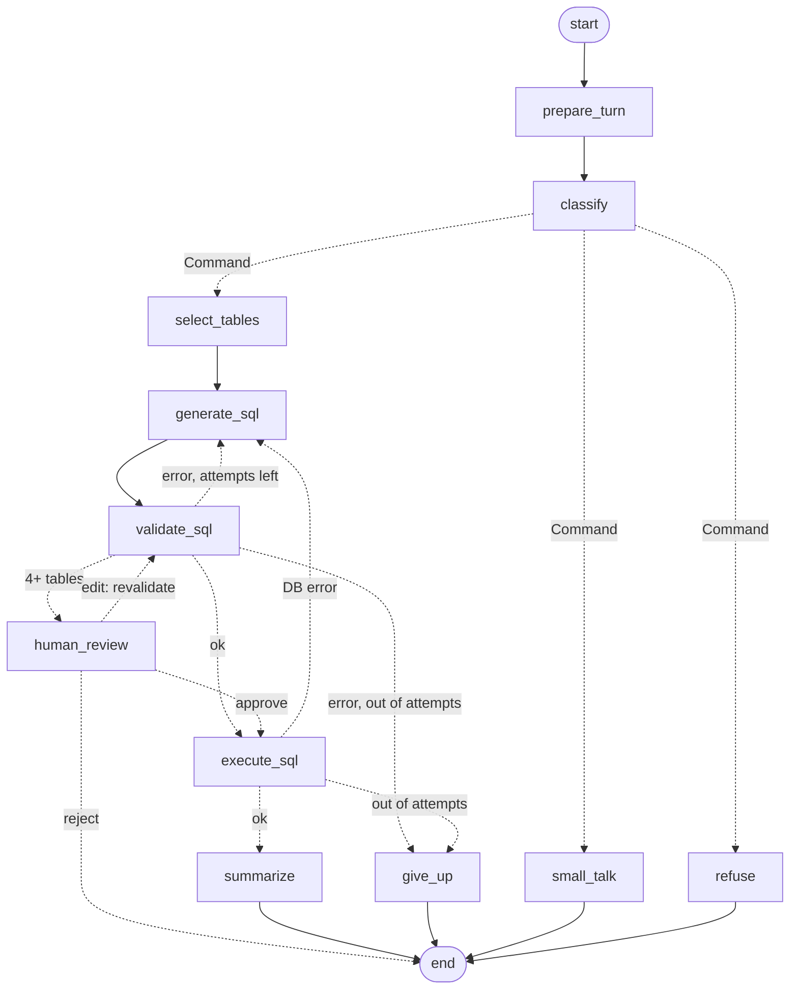

# sql-analyst-agent

A Text-to-SQL analyst agent built with **LangGraph**. A non-technical user asks a business question in plain English. The agent picks the relevant tables, writes SQL, checks it is safe, runs it, fixes its own errors, asks a human before running expensive queries, and answers in plain English with the SQL shown. It remembers the conversation, so "now only for Texas" works as a follow-up.

```
you> Top 5 products by revenue in 2025?
  [route]    intent = data_question
  [tables]   orders, order_items, products
  [sql #1]   SELECT SUM(revenue) FROM orders
  [blocked]  OperationalError: no such column: revenue
  [sql #2]   SELECT p.name, ROUND(SUM(oi.quantity * oi.unit_price), 2) AS revenue FROM ...
  [valid]    passed guardrails + EXPLAIN
  [ran]      5 rows
agent> The 4K Monitor led 2025 with $137,029.71 in revenue, followed by ...
```
*(That trace was captured from the real CLI code driven by a scripted LLM. See "Eval results" for what has and hasn't been measured with a live model.)*

## The problem

Business users wait on analysts for simple numbers. Handing them a raw LLM that writes SQL creates three new problems: it **writes wrong-but-plausible SQL** (revenue from list price, canceled orders included), it **can be talked into writing destructive SQL**, and it **can't recover** when a query fails. This project treats the LLM as an untrusted, fallible component inside a deterministic, testable control loop.

## How it works



Dashed edges are decided at runtime: `classify` and `human_review` route with `Command(goto=...)`, while `validate_sql` and `execute_sql` route through `add_conditional_edges` routing functions.

## Features

- **Two-step schema retrieval:** a cheap one-line overview of every table, then full DDL plus 3 sample rows for only the chosen tables.
- **Semantic layer:** plain-English table meanings and business rules (what "revenue" means, how to filter quarters) injected into the prompts.
- **Self-correcting SQL loop:** the exact validator or database error and the failed SQL go back into the prompt, bounded by `MAX_ATTEMPTS`.
- **Five safety layers:** read-only connection, sqlglot AST validator, automatic `LIMIT`, query timeout, and human approval for wide joins (details below).
- **Human-in-the-loop:** `interrupt()` pauses the graph. Approve, reject, or edit the SQL, and edits are re-validated.
- **Conversation memory:** a SQLite checkpointer per `thread_id`. Answers are stored together with the SQL used, so follow-ups refine the previous query.
- **Time travel:** every step is a checkpoint, exposed through `GET /threads/{id}/history`.
- **Provider-agnostic:** `LLM_MODEL=openai:...` or `anthropic:...` through `init_chat_model`, or `claude-cli:sonnet` to run on a Claude subscription through headless Claude Code, with no API key.
- **Offline test suite:** 60 tests, no API key, no cost, using a scripted fake LLM against a real seeded database.
- **Eval harness:** execution accuracy on a 20-question golden set, by difficulty, with attempts, first-try rate and latency.

## Quickstart

```bash
git clone https://github.com/pranavparuchur1/sql-analyst-agent && cd sql-analyst-agent
make setup              # venv + deps + seeds data/shop.db
cp .env.example .env    # then set LLM_MODEL and the matching API key (or claude-cli:sonnet, below)
make test               # 60 offline tests, no key needed
make cli                # chat in the terminal
make api                # http://localhost:8000/docs
```

Without `make`: `python -m venv .venv`, activate it, `pip install -r requirements.txt`, `python -m data.seed`, then `python -m app.cli` or `uvicorn app.api:app`.

**No API key? Use a Claude subscription.** If [Claude Code](https://claude.com/claude-code) is installed and signed in (`claude auth login`), set `LLM_MODEL=claude-cli:sonnet` (or `opus` / `haiku`). Each LLM call then runs headless `claude -p` with tools disabled and its own short system prompt, and counts against your plan's usage limits instead of API billing. API credentials are stripped from the child process, so it can't fall back to API billing. This mode is for personal development and evals; a deployed service should use an API key. See [app/claude_cli_llm.py](app/claude_cli_llm.py).

Docker (seeds the DB at build time; checkpoints persist in a named volume):

```bash
docker build -t sql-analyst-agent .
docker run --rm -p 8000:8000 --env-file .env -v sql-agent-state:/state sql-analyst-agent
```

## API

```bash
# Ask a question (omit thread_id to start a new conversation)
curl -s localhost:8000/ask -H 'content-type: application/json' \
  -d '{"question": "Top 5 products by revenue in 2025?"}'
# -> {"thread_id": "8f1c...", "status": "answered", "answer": "...", "sql": "SELECT ...", "columns": [...], "rows": [...], "attempts": 1}

# Follow up on the same thread. This one joins 4 tables, so it pauses for approval:
curl -s localhost:8000/ask -H 'content-type: application/json' \
  -d '{"question": "now only for Texas", "thread_id": "8f1c..."}'
# -> {"thread_id": "8f1c...", "status": "needs_approval", "approval": {"sql": "...", "reason": "Query joins 4 tables ...", ...}}

# Approve, reject ("approved": false) or edit ("edited_sql": "SELECT ...")
curl -s localhost:8000/approve -H 'content-type: application/json' \
  -d '{"thread_id": "8f1c...", "approved": true}'

curl -s localhost:8000/threads/8f1c...           # messages, last SQL, error_history
curl -s localhost:8000/threads/8f1c.../history   # every checkpoint (time travel)
curl -s localhost:8000/health
```

`/ask` returns **409** while a thread is waiting for approval, and **502** if the LLM provider fails.

## Safety layers

| Layer | Where | Stops |
|---|---|---|
| Read-only connection (`?mode=ro`) | `app/db.py` | Any write, even if every other check fails |
| sqlglot AST validator | `app/validator.py` | Non-SELECT roots, writes hidden in CTEs, multiple statements, `PRAGMA`/`ATTACH`, unknown tables |
| Automatic `LIMIT` + row cap | `app/validator.py`, `app/db.py` | Accidental million-row results |
| Timeout (`set_progress_handler`) | `app/db.py` | Runaway queries and accidental cartesian products |
| Human approval (4+ tables) | `app/graph.py` | Expensive joins and "plausible but wrong" answers, both of which concentrate in wide joins |

## Design decisions and trade-offs

- **LangGraph over a single LCEL chain.** The agent needs cycles (retry), branches (routing), pauses (approval) and persisted state. Chains are one-way pipelines. The cost is more concepts to learn, and the benefit is that every step is an inspectable, testable node.
- **Command for routing *from* a node, conditional edges for policy *over* state.** `classify` decides and writes `intent` in one atomic step. The retry/give-up/approve policy is a pure function, so it can be reasoned about and tested on its own.
- **Deterministic guardrails, not an LLM judge.** Safety checks run as plain Python with sqlglot. They're free, instant and can't be prompt-injected. A regex would reject a column named `deleted_flag` and miss `WITH x AS (DELETE ...)`.
- **Errors are feedback, not exceptions.** Validator and DB errors are written to state and shown to the LLM on retry. Only transient *provider* errors (rate limits, timeouts) use `RetryPolicy`. Retrying a bad SQL with the same prompt would just burn tokens.
- **Approval by rule (table count), not by asking the LLM.** It's predictable and auditable. The trade-off: a 4-table query can be cheap and a 2-table one expensive. Using `EXPLAIN` cost estimates in Postgres would be a better signal.
- **History window of 6 messages.** That's enough for follow-ups, and prompt size stays bounded no matter how long the conversation gets. Storing `[SQL used]` in the answer gives follow-ups a concrete query to modify.
- **Native structured outputs (`method="json_schema"`).** Forced tool calling isn't supported on some newer models, so constrained decoding is both more compatible and more reliable. This was found by a live smoke test, which no offline test could have caught.
- **SQLite for zero setup, behind a `Database` protocol.** A Postgres implementation would use a read-only role and `statement_timeout` instead of `mode=ro` and the progress handler.

## Eval results

Measured on 2026-10-21 with Claude Sonnet 5.5 through a Claude subscription (`claude-cli:sonnet`, 4 parallel workers). The full report is in [evals/report.md](evals/report.md).

| Metric | Value |
|---|---|
| Execution accuracy | **100% (20/20)**: easy 6/6, medium 8/8, hard 6/6 |
| First-try success | 100% (20/20), avg 1.00 SQL attempts |
| LLM calls per question | 4.0 (router, tables, SQL, answer) |
| API-equivalent cost | $0.027 per question ($0.54 total, not billed on a subscription) |
| Latency p50 / p95 | 19.7s / 23.7s (includes starting a CLI process for every call; API latency would be lower) |

**How to read this honestly:** a perfect score means this golden set is **saturated** for a frontier model. It's useful as a regression test, but it can't tell good prompts from great ones. And because every query was right first time, **the eval never exercised the self-correction loop**. That loop is covered only by the offline tests. The next step is a harder set: ambiguous wording, misleading column names, multi-step questions, and questions that *should* be refused or should ask for clarification. Smaller models (`make eval MODEL=claude-cli:haiku`) would also show more spread.

```bash
make eval                                   # uses LLM_MODEL
make eval MODEL=claude-cli:haiku            # compare models (subscription mode)
make eval MODEL=openai:gpt-4.1-mini         # or any API model
```

The gold set is verified too: all 20 gold queries (6 easy, 8 medium, 6 hard, covering multi-join, CTE + window function, NOT EXISTS and period-over-period growth) run and return non-empty, non-NULL results (`make check-gold`). Two candidate questions were replaced because their gold answers were 0 or empty, which a broken query could match by accident. The scorer itself is unit-tested.

**Metric:** a prediction counts as correct if every gold result column matches some predicted column (sorted values, floats rounded to 2 dp). This tolerates column order, row order and extra columns. **Known limitation:** columns are compared independently, so it doesn't verify row pairing (a test documents this). 20 questions also give wide confidence intervals: one question is 5 points.

## What I'd do next

- **Postgres** implementation of `Database`: read-only role, `statement_timeout`, and `EXPLAIN` cost-based approval instead of table count.
- **Vector index of past good queries** (question → verified SQL), retrieved as dynamic few-shot examples via `example_selector`.
- **LangSmith tracing** for per-node latency, token cost and failure clustering, plus online evals on real traffic.
- **Caching** of identical (question, schema version) pairs, and of `schema_for` results.
- **Streamlit UI** with result tables, auto-charts and an approve/edit button.
- A larger, human-reviewed golden set with confidence intervals, plus a row-pairing-aware scorer.

## Repo layout

```
app/        config, db (+semantic layer), schemas, prompts, state, validator, graph, api, cli
data/       seed.py (deterministic synthetic e-commerce DB)
evals/      golden.jsonl, run_evals.py, report.md
tests/      fakes.py (ScriptedLLM), validator / graph / api / eval tests
LEARN.md    study guide: concepts, walkthrough, interview Q&A, exercises
```
